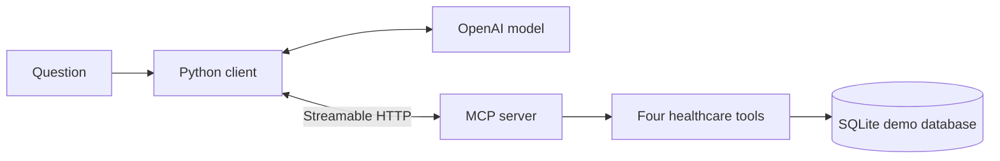

# Healthcare MCP Server + OpenAI

## Browser application and Vercel deployment

The project includes **Healthcare Explorer**, a responsive browser interface for
the patient directory, risk summaries, readmission indicators, database schema,
and an OpenAI assistant. The original CLI and local MCP server remain available.

To run the web application locally:

```powershell
.\.venv\Scripts\python.exe -m pip install -r requirements.txt
.\.venv\Scripts\python.exe -m uvicorn app:app --host 127.0.0.1 --port 8000
```

Open `http://127.0.0.1:8000`. The web entrypoint generates a separate temporary
database from the illustrative seed definitions. It never opens the local
`healthcare_mcp_server/patients.db`, and it needs no manual seed step. This data is
read only during use and is recreated on a new runtime instance.

The browser's AI assistant requires `OPENAI_API_KEY`, `LLM_MODEL`, and a private
`DEMO_ACCESS_CODE` in the environment. Enter the access code in the AI assistant
panel. It is sent in a request header, is not stored in browser storage, and is
never included in public responses. The directory and schema work without it.

For Vercel, import this repository with the **FastAPI** framework preset and the
repository root as the root directory. Root `app.py`, `requirements.txt`,
`.python-version`, and `vercel.json` configure the deployment. Save the OpenAI key
and access code as Secret environment variables, select `gpt-4o-mini` for
`LLM_MODEL`, and deploy. `.vercelignore` excludes local databases, `.env`, the
virtual environment, and runtime reports from source uploads. Never upload real
patient data. The deployed `/mcp` endpoint uses stateless JSON HTTP responses so
clients do not depend on a particular function instance.

The app exposes `/api/health`, `/api/patients`, `/api/patients/{id}`,
`/api/schema`, `/api/ask`, and `/mcp`. Billable questions are access-code protected
and bounded to 1,000 input characters and 100 seconds overall; the code is not a
replacement for full user accounts or distributed rate limiting.

GitHub Actions installs the root requirements and exercises the web APIs and
stateless MCP protocol alongside the original workflow tests. For local testing,
use the root requirements to include the web dependency.

A Python demonstration of connecting an OpenAI tool-calling client to a
**Model Context Protocol (MCP)** server over **Streamable HTTP**. Ask questions
in natural language; the client discovers the available tools, lets the model
request them, executes those requests through MCP, and returns an answer with
the names of the tools it used.

The server exposes patient risk summaries, readmission insights, database schema
inspection, and bounded read-only SQL queries. The default model is
**`gpt-4o-mini`**. SQLite keeps the demo easy to run locally; Redis is not required.

> This is a learning project using illustrative seed records. The risk scores
> are rule-based demonstrations, not validated clinical predictions. Do not use
> them to diagnose, prescribe treatment, or make patient-care decisions.

## Features

- Four discoverable MCP tools with generated input schemas.
- OpenAI client with a bounded model/tool loop, request timeout, and limited retries.
- Workspace-relative `.env` loading, validation, and environment-variable overrides.
- Read-only SQLite connections for tools, 1–500 query-row limits, SQL authorizer
  checks, and execution-step limits for expensive queries.
- Readmission windows that exclude future visits and use the latest completed discharge.
- A seed script containing 10 illustrative patients and related visits, diagnoses,
  medications, and lab results.
- 13 regression tests plus a verifier that exercises a real local HTTP MCP server.
- A localhost default; API keys, databases, and runtime reports are excluded from Git.

## How it works



The client initializes an MCP session and discovers tool schemas. OpenAI receives
the question and schemas, returns tool requests, and receives their results after
the client executes them through the server. It can repeat this process until it
returns a final answer or reaches `AGENT_MAX_ROUNDS`. The MCP server can also be
used by other compatible clients without an OpenAI key.

**Data flow:** client questions and selected tool results are sent to OpenAI.
Use the included demonstration data for examples and live checks. The OpenAI
API key stays in the local client configuration.

## Available tools

| MCP tool | Arguments | Result |
| --- | --- | --- |
| `patient_risk_summary` | `patient_id: int` | Demographics, chronic-condition and medication counts, abnormal labs, scoring signals, and LOW / MEDIUM / HIGH tier |
| `readmission_insights` | `patient_id: int` | Recent-visit counts, last discharge, recurring diagnoses, LOW / MODERATE / HIGH risk, and a summary |
| `database_schema` | None | Table names, columns, types, and row counts |
| `query_database` | `sql_query: str`, `max_rows: int = 50` | Bounded SELECT results or a structured error |

The risk summaries use deterministic rules in the tool code. OpenAI explains
and combines tool results; it does not calculate a separate clinical risk score.

## Requirements

- Python **3.10 or newer**. Local verification used Windows and Python 3.14.6.
- An OpenAI API key with access to the configured model for the client and live checks.
- Internet access to install dependencies and call OpenAI.

No OpenAI key is needed to run the server, regression tests, or local MCP verifier.

## Quick start

Clone the repository:

```bash
git clone https://github.com/harshgavandit/healthcare-mcp-openai.git
cd healthcare-mcp-openai
```

### Windows / PowerShell

```powershell
python -m venv .venv
.\.venv\Scripts\python.exe -m pip install -r healthcare_mcp_server\requirements.txt
Copy-Item .env.example .env
```

Edit `.env` and replace the key placeholder with your own key:

```dotenv
OPENAI_API_KEY=replace-with-your-key
LLM_MODEL=gpt-4o-mini
```

Initialize a **new demonstration database**, then start the server:

```powershell
.\.venv\Scripts\python.exe healthcare_mcp_server\seed_data.py
.\.venv\Scripts\python.exe healthcare_mcp_server\server.py
```

In a second terminal, from the repository root:

```powershell
.\.venv\Scripts\python.exe healthcare_mcp_server\client.py "How many patients are in the database?"
.\.venv\Scripts\python.exe healthcare_mcp_server\client.py "Summarize the risk factors for patient 4."
.\.venv\Scripts\python.exe healthcare_mcp_server\client.py "What readmission indicators are recorded for patient 1?"
```

### macOS / Linux

```bash
python3 -m venv .venv
.venv/bin/python -m pip install -r healthcare_mcp_server/requirements.txt
cp .env.example .env
# Edit .env to set your OpenAI key before running the client.
.venv/bin/python healthcare_mcp_server/seed_data.py
.venv/bin/python healthcare_mcp_server/server.py
```

In another terminal:

```bash
.venv/bin/python healthcare_mcp_server/client.py "How many patients are in the database?"
```

The default endpoint is **`http://127.0.0.1:8000/mcp`**. Stop the server with
`Ctrl+C` in its terminal.

**Existing local installation:** keep your existing `.env` and database.
`seed_data.py` deletes existing records before inserting its demo dataset, so
run it only when you intend to create or reset that dataset. The SQLite database
is not included in Git; fresh clones must run the seed step.

## Configuration

The root `.env` is loaded independently of the working directory. Existing
process environment variables take precedence. `.env.example` contains every
supported setting and no usable credentials.

| Variable | Default | Purpose |
| --- | --- | --- |
| `OPENAI_API_KEY` | Required for client/live checks | OpenAI API credential |
| `LLM_MODEL` | `gpt-4o-mini` | Model for tool requests and final answers |
| `OPENAI_TIMEOUT_SECONDS` | `30` | Timeout per OpenAI request |
| `OPENAI_MAX_COMPLETION_TOKENS` | `1200` | Generated-token budget per model call |
| `AGENT_MAX_ROUNDS` | `8` | Maximum model/tool iterations per question |
| `MCP_HOST` | `127.0.0.1` | Server bind address |
| `MCP_PORT` | `8000` | Server port |
| `MCP_SERVER_URL` | `http://127.0.0.1:8000/mcp` | Client target |

Change `MCP_SERVER_URL` together with the host or port when using the example
configuration. Do not put API keys in source code or commit `.env`.

`healthcare_mcp_server/requirements.lock.txt` records exact dependencies from
local verification on Windows/Python 3.14. Use `requirements.txt` for the general
installation; the lock file includes Windows-specific packages.

## Tests and verification

From the repository root on Windows:

```powershell
.\.venv\Scripts\python.exe -m unittest discover -s healthcare_mcp_server\tests -v
.\.venv\Scripts\python.exe -m pip check
.\.venv\Scripts\python.exe healthcare_mcp_server\verify.py
```

On macOS/Linux, use `.venv/bin/python` and forward slashes in those commands.

The regression suite uses temporary fixtures. The MCP verifier requires a
seeded database and starts its own server on a temporary local port. It checks
all four tools, existing and missing patient IDs, query limits, rejection of
writes and extension loading, and an unchanged database SHA-256.

For an **optional live check** on the demonstration dataset:

```powershell
.\.venv\Scripts\python.exe healthcare_mcp_server\verify.py --live
```

This sends schema counts to OpenAI and verifies an actual model/tool response.
It uses your API quota. Reports are written to `verification/` locally and are
excluded from Git. Live failures are reported separately from local tool checks.

Local checks passed before initial publication: 13 regression tests, dependency
validation, Python compilation, HTTP MCP checks, and OpenAI integration. An
additional CLI test used an entirely generated fixture and exercised both schema
and SQL tools. GitHub Actions runs regression tests, dependency validation, and
local MCP verification without an API key; it does not run live OpenAI requests.

## Project structure

```text
.
├── .env.example                  # Credential-free configuration template
├── .github/workflows/ci.yml       # Local checks on Linux/Python 3.12 and 3.14
├── README.md
├── scripts/check_publication.py   # Scan tracked files before publication
└── healthcare_mcp_server/
    ├── client.py                 # OpenAI ↔ MCP tool-calling client
    ├── server.py                 # FastMCP Streamable HTTP application
    ├── settings.py               # Environment loading and validation
    ├── db.py                     # SQLite connection and table initialization
    ├── seed_data.py               # Illustrative dataset; resets existing records
    ├── verify.py                  # Real HTTP MCP and optional live API checks
    ├── requirements.txt
    ├── requirements.lock.txt
    ├── tests/test_workflow.py
    ├── tools/
    │   ├── risk_summary.py
    │   ├── readmission.py
    │   ├── schema_tool.py
    │   └── query_tool.py
    └── documentation/            # Original MCP tutorial and supporting material
```

## Troubleshooting

| Symptom | What to check |
| --- | --- |
| Missing `OPENAI_API_KEY` | Edit the root `.env`; check for an overriding process environment variable |
| OpenAI HTTP 401 | Verify that the API key is valid |
| OpenAI HTTP 429 | Check the project's API quota, billing, and rate limits |
| Cannot connect to MCP | Start `server.py` and check that the URL matches its port |
| Missing database or tables | Run `seed_data.py` for a fresh demo installation |
| Model output truncated | Increase `OPENAI_MAX_COMPLETION_TOKENS` within your intended budget |
| Agent reaches round limit | Simplify the question or adjust `AGENT_MAX_ROUNDS` |
| Recent-visit counts are zero | The seed visits are historical; windows use the actual current date |

## Scope and limits

The server defaults to localhost and has no authentication or distributed rate
limiter. Public repository visibility does not expose the running server. Public
service deployment needs separate access control and hosting configuration.
Keep private records and credentials out of the repository. Results here show
local behavior and API integration, not production capacity or medical validity.

See the [MCP tutorial](healthcare_mcp_server/documentation/MCP_Documentation.md)
and [original setup guide](healthcare_mcp_server/documentation/README.md) for
background. The commands in this README describe the current implementation.
